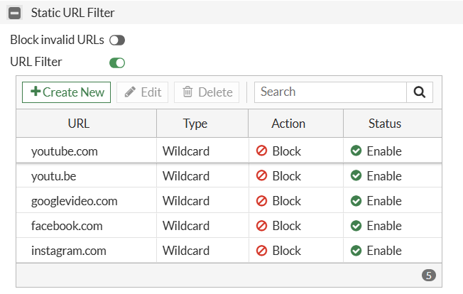

---
# **Block a URL on FortiGate Using Web Filter**

## Overview

FortiGate Web Filter allows network administrators to block access to specific websites like: `www.youtube.com, www.facebook.com, www.instagram.com`, domains, and URL paths. 

### Configuration workflow

<div>

<svg xmlns="http://www.w3.org/2000/svg"
     viewBox="0 0 600 180"
     width="100%"
     role="img"
     aria-label="FortiGate URL filtering workflow">

  <rect width="600" height="180" rx="12" fill="#f1f5f9"/>

  <rect x="15" y="35" width="165" height="100"
        rx="10" fill="#fff" stroke="#dc2626" stroke-width="2"/>

  <text x="97" y="65" text-anchor="middle"
        font-size="15" font-weight="bold" fill="#172554">
    Step 1
  </text>
  <text x="97" y="90" text-anchor="middle"
        font-size="12" fill="#334155">
    Create URL Filter Profile
  </text>

  <path d="M185 85 H215" stroke="#dc2626" stroke-width="3"/>
  <polygon points="215,79 225,85 215,91" fill="#dc2626"/>

  <rect x="230" y="35" width="165" height="100"
        rx="10" fill="#fff" stroke="#dc2626" stroke-width="2"/>

  <text x="312" y="65" text-anchor="middle"
        font-size="15" font-weight="bold" fill="#172554">
    Step 2
  </text>
  <text x="312" y="88" text-anchor="middle"
        font-size="12" fill="#334155">
    Apply Web Filter Profile
  </text>
  <text x="312" y="105" text-anchor="middle"
        font-size="12" fill="#334155">
    to Firewall Policy
  </text>

  <path d="M400 85 H430" stroke="#dc2626" stroke-width="3"/>
  <polygon points="430,79 440,85 430,91" fill="#dc2626"/>

  <rect x="445" y="35" width="140" height="100"
        rx="10" fill="#fff" stroke="#16a34a" stroke-width="2"/>

  <text x="515" y="65" text-anchor="middle"
        font-size="15" font-weight="bold" fill="#166534">
    Step 3
  </text>
  <text x="515" y="90" text-anchor="middle"
        font-size="12" fill="#334155">
    Test &amp; Verify
  </text>

</svg>

</div>

**Step 1 — Create the URL filter**  
Security Profiles → Web Filter

**Step 2 — Apply the Web Filter profile**  
Policy & Objects → Firewall Policy

**Step 3 — Test and verify**

---
## Step 1. Create a Web Filter profile

1. Log in to the FortiGate administrative GUI.
	
2. Navigate to **Security Profiles → Web Filter**.
	
3. Click Create **New**
	
4. Enter a **profile name**, for example, `Block_Social_Media`. 
    
5. Locate the **Static URL Filter** section.
    
6. Enable **URL Filter**.

### Add the URL to block

In the Static URL Filter section:

1. Click Create **New**.
    
2. Enter the URL pattern. `www.youtube.com, www.facebook.com, www.instagram.com`
    
3. Select the filter type **Wildcard**.
    
4. Set the action to **Block**.
    
5. Set the status **Enabled**.
    
6. **Save** the entry and then save the profile.


Use the following example configuration: (Screenshot):



## Step 2: Apply the Web Filter to a firewall policy

A URL filter will not protect users unless the applicable traffic passes through a firewall policy with the Web Filter profile enabled.

1. Go to **Policy & Objects → Firewall Policy.**
    
2. Find the policy that allows LAN users to access the Internet (**LAN-to-WAN**).
    
3. Click **Edit**.
    
4. Locate the **Security Profiles** section.
    
5. Enable **Web Filter**.
    
6. Select the `Block_Youtube` profile created earlier.
    
7. Select `certificate-inspection` under SSL Inspection, as an initial configuration.
    
8. Click OK to **save**.

Use the following example configuration: (Screenshot):


## Step 3: Test & Verify

From any client computer connected through the FortiGate:

1. Open a browser.
    
2. Navigate to `https://www.youtube.com`.
    
3. Confirm that access is **blocked**.
    
4. Test another website to verify that general Internet access still works.

---
### Expected result

**Blocked website-** The browser should display a FortiGate block or replacement page, or the request may fail depending on the inspection and browser configuration.

**Other websites should be run-** Websites not matched by a blocking rule should remain accessible.

## Check Web Filter logs

If the website is still accessible, check the **logs**:

1. Navigate to **Log & Report → Security Events.**
    
2. Open the **Web Filter events**.
    
3. Filter for the **client's source IP address** or the **destination hostname**.
    
4. Review the action, **matched URL**, **profile**, and **policy ID**.
	
5. Look for an entry with an action such as `blocked` and a message indicating that the URL matched the local URL filter.

Use the following example configuration: (Screenshot):


<hr style="border: none; height: 3px; background-color: #333;">
# **Using CLI**

## Overview

FortiGate firewalls also allow administrators to block Web Filter feature and firewall policies using  graphical user interface (GUI) as well as Command Line Interface (CLI).

## Step 1: Create the URL filter list

1. Log in to the FortiGate firewall using **SSH**, a **console connection**, or the **CLI Console** available in the web interface.

2. First, create a URL filter table and add a rule to block social media sites.

```
config webfilter profile
    edit "Block-Social-Media"
        config ftgd-wf
        end
        config web
            set urlfilter-table enable
        end
        config urlfilter
            edit 1
                set name "Social-Media-URLs"
                set comment "Block YouTube Facebook Instagram"
                set action block
                set status enable
                config entries
                    edit 1
                        set url "*youtube.com"
                        set type wildcard
                        set action block
                    next
                    edit 2
                        set url "*facebook.com"
                        set type wildcard
                        set action block
                    next
                    edit 3
                        set url "*instagram.com"
                        set type wildcard
                        set action block
                    next
                end
            next
        end
    next
end
```

| CLI Command                    | Explanation                             |
| ------------------------------ | --------------------------------------- |
| `config webfilter urlfilter`   | Enter Static URL Filter configuration   |
| `edit 1`                       | Select or create URL filter list ID 1   |
| `set name "Social-Media-URLs"` | Set the filter list name                |
| `config entries`               | Enter URL entries configuration         |
| `edit 1` / `edit 2` / `edit 3` | Create or select individual URL entries |
| `set url "*youtube.com"`       | Define the YouTube URL pattern          |
| `set url "*facebook.com"`      | Define the Facebook URL pattern         |
| `set url "*instagram.com"`     | Define the Instagram URL pattern        |
| `set type wildcard`            | Use wildcard URL matching               |
| `set action block`             | Block matching URLs                     |
| `set status enable`            | Enable the URL filter entry             |
| `next`                         | Finish the current entry                |
| `end`                          | Exit the current configuration section  |

## Step 2: Create the Web Filter profile and attach the URL list

```
config webfilter profile
    edit "Block-Social-Media"
        config web
            set urlfilter-table 1
        end
    next
end
```

***Note:** The number `1` refers to the URL filter list created in Step 2*

| CLI Command                 | Explanation                                     |
| --------------------------- | ----------------------------------------------- |
| `config webfilter profile`  | Enter Web Filter profile configuration mode     |
| `edit "Block-Social-Media"` | Create or edit the Web Filter profile           |
| `config web`                | Enter Web Filter settings                       |
| `set urlfilter-table 1`     | Associate URL filter list ID 1 with the profile |
| `end`                       | Exit Web Filter settings                        |

## Step 3: Apply the profile to an existing firewall policy

First, identify your LAN-to-WAN policy ID:

``show firewall policy``

Suppose your existing policy ID is `5`. Apply the profile without recreating the policy:

```
config firewall policy
    edit 5
        set utm-status enable
        set webfilter-profile "Block-Social-Media"
        set ssl-ssh-profile "certificate-inspection"
    next
end
```

Replace `5` with your actual policy ID. The SSL inspection setting above enables certificate inspection; do not overwrite an existing, more suitable inspection profile without checking its requirements.

If you have multiple LAN-to-WAN policies, repeat Step 4 for each policy that should block these sites.

| CLI Command                                    | Explanation                                         |
| ---------------------------------------------- | --------------------------------------------------- |
| `config firewall policy`                       | Enter firewall policy configuration mode            |
| `edit 5`                                       | Select firewall policy ID 5                         |
| `set utm-status enable`                        | Enable UTM security inspection features             |
| `set webfilter-profile "Block-Social-Media"`   | Apply the Web Filter profile to the firewall policy |
| `set ssl-ssh-profile "certificate-inspection"` | Apply the SSL/SSH inspection profile                |

## Step 4: Verify the configuration

```
show webfilter urlfilter
show webfilter profile "Block-Social-Media"
show firewall policy 5
```

| CLI Command                                   | Explanation                                                  |
| --------------------------------------------- | ------------------------------------------------------------ |
| `show webfilter urlfilter`                    | Display configured Static URL Filter lists and their entries |
| `show webfilter profile "Block-Social-Media"` | Display the Web Filter profile configuration                 |
| `show firewall policy 5`                      | Display the configuration of firewall policy ID 5            |

Test YouTube, Facebook, and Instagram from a client whose traffic passes through the configured policy.

Note: HTTPS, QUIC/HTTP3, alternate domains, and application-specific endpoints can affect blocking coverage. For more comprehensive blocking, you may need appropriate SSL inspection, QUIC control, and FortiGuard application or category filtering.


***Official Reference:** Fortinet's FortiOS 7.4.8 Administration Guide. Your interface may differ slightly.*
Reference Source: [Fortinet — Static URL Filter and verification](https://docs.fortinet.com/document/fortigate/7.4.8/administration-guide/371670/static-url-filter) 

### Important Consideration: 

1. **Correct Policy ID:** Verify that you are modifying the correct LAN-to-WAN firewall policy handling the client's traffic.
    
2. **Profile Association:** Ensure the Static URL Filter list is linked to the intended Web Filter profile and that the profile is applied to the relevant firewall policies.
    
3. **Wildcard Matching:** Configure URL patterns carefully, such as `*facebook.com`, because matching behavior may vary with the pattern and FortiOS version.
    
4. **HTTPS Inspection:** URL filtering capabilities depend on the SSL inspection profile and the visibility available for encrypted traffic.
    
5. **Additional Domains:** Applications may use additional domains, content delivery networks (CDNs), and alternate endpoints. Blocking one domain may not block the entire application.
    
6. **QUIC and HTTP/3:** These protocols can affect filtering behavior. Review QUIC handling if blocking is incomplete.
    
7. **Existing Configuration:** Review existing firewall and security profiles before making changes to avoid overwriting required settings.
      
8. **FortiOS Compatibility:** Confirm command syntax and supported features for your FortiGate FortiOS version.
    
9. **Production Deployment:** Test changes in a controlled environment before applying them to production networks.

## Conclusion

Blocking a website on FortiGate using CLI involves three main tasks: configuring a Static URL Filter, associating it with a Web Filter profile, and applying that profile to the appropriate firewall policy.


<div>
<svg xmlns="http://www.w3.org/2000/svg" width="1200" height="1500" viewBox="0 0 1200 1500">
  <defs>
    <linearGradient id="navy" x1="0" y1="0" x2="1" y2="0">
      <stop offset="0" stop-color="#123d69"/>
      <stop offset="1" stop-color="#0877b9"/>
    </linearGradient>
    <linearGradient id="blue" x1="0" y1="0" x2="0" y2="1">
      <stop stop-color="#eaf5ff"/>
      <stop offset="1" stop-color="#fff"/>
    </linearGradient>
    <marker id="arrow" markerWidth="10" markerHeight="10" refX="8" refY="3" orient="auto">
      <path d="M0 0 L8 3 L0 6Z" fill="#1682d4"/>
    </marker>
    <marker id="redArrow" markerWidth="10" markerHeight="10" refX="8" refY="3" orient="auto">
      <path d="M0 0 L8 3 L0 6Z" fill="#dc3545"/>
    </marker>
    <style>
      text{font-family:Arial,Helvetica,sans-serif;fill:#163452}
      .heading{font-size:25px;font-weight:bold;fill:white}
      .subheading{font-size:19px;font-weight:bold}
      .body{font-size:16px}
      .small{font-size:14px}
      .mono{font-family:Consolas,monospace;font-size:13px;fill:#15365c}
      .panel{fill:white;stroke:#c7d9e9;stroke-width:1.5}
      .line{stroke:#1682d4;stroke-width:3;fill:none;marker-end:url(#arrow)}
    </style>
  </defs>

  <rect width="1200" height="1500" fill="#f4f8fc"/>

  <!-- Header -->
  <rect width="1200" height="100" fill="url(#navy)"/>
  <g transform="translate(30 25)">
    <rect width="52" height="48" rx="9" fill="#fff"/>
    <path d="M11 12H41 M11 21H41 M11 30H41 M11 39H41"
          stroke="#0877b9" stroke-width="5"/>
    <path d="M20 8V43 M32 8V43" stroke="#0877b9" stroke-width="3"/>
  </g>
  <text x="100" y="45" font-size="27" font-weight="bold" fill="white">FORTIGATE</text>
  <text x="100" y="73" font-size="16" fill="#d7edff">WEB FILTER CONFIGURATION GUIDE</text>
  <text x="1165" y="43" font-size="17" text-anchor="end" fill="white">HITOP | NETWORK SECURITY</text>
  <text x="1165" y="72" font-size="15" text-anchor="end" fill="#d7edff">CLI • URL FILTER • FIREWALL POLICY</text>

  <!-- Network overview -->
  <rect x="25" y="120" width="1150" height="245" rx="15" class="panel"/>
  <text x="50" y="157" class="subheading">01 — NETWORK TRAFFIC OVERVIEW</text>

  <!-- Client -->
  <rect x="50" y="185" width="205" height="135" rx="12" fill="#eaf5ff" stroke="#8fc5ef"/>
  <g transform="translate(118 205)" stroke="#22577b" stroke-width="3" fill="#d5e9f9">
    <rect x="0" y="0" width="70" height="44" rx="4"/>
    <path d="M-7 49H77L68 57H2Z" fill="#a4c9e8"/>
  </g>
  <text x="152" y="285" text-anchor="middle" class="subheading">LAN Clients</text>
  <text x="152" y="306" text-anchor="middle" class="small">PCs • Laptops • Users</text>

  <path d="M255 250H335" class="line"/>

  <!-- Firewall -->
  <rect x="350" y="185" width="300" height="135" rx="12" fill="#fff5e7" stroke="#f3b65d"/>
  <g transform="translate(440 207)">
    <rect width="120" height="52" rx="5" fill="#e6edf4" stroke="#244f71" stroke-width="2"/>
    <path d="M0 17H120 M0 35H120 M40 0V17 M80 0V17 M20 17V35 M60 17V35 M100 17V35"
          stroke="#244f71" stroke-width="2"/>
    <rect x="12" y="40" width="10" height="5" fill="#21a366"/>
    <rect x="29" y="40" width="10" height="5" fill="#21a366"/>
    <rect x="46" y="40" width="10" height="5" fill="#e6a23c"/>
  </g>
  <text x="500" y="284" text-anchor="middle" class="subheading">FortiGate Firewall</text>
  <text x="500" y="305" text-anchor="middle" class="small">Web Filter + Security Inspection</text>

  <path d="M650 250H730" class="line"/>

  <!-- Internet -->
  <circle cx="790" cy="245" r="48" fill="#e7f3ff" stroke="#1682d4" stroke-width="2"/>
  <circle cx="790" cy="245" r="29" fill="none" stroke="#1682d4" stroke-width="2"/>
  <ellipse cx="790" cy="245" rx="13" ry="29" fill="none" stroke="#1682d4" stroke-width="2"/>
  <path d="M762 235H818 M762 255H818" stroke="#1682d4" stroke-width="2"/>
  <text x="790" y="313" text-anchor="middle" class="subheading">Internet</text>

  <path d="M840 245H885" stroke="#dc3545" stroke-width="3" stroke-dasharray="7 5" fill="none" marker-end="url(#redArrow)"/>

  <!-- Blocked sites -->
  <rect x="890" y="185" width="255" height="135" rx="12" fill="#fff0f1" stroke="#ed9da5"/>
  <circle cx="920" cy="215" r="13" fill="#dc3545"/>
  <path d="M914 209L926 221 M926 209L914 221" stroke="white" stroke-width="2.5"/>
  <text x="943" y="221" font-size="17" font-weight="bold" fill="#c62838">ACCESS BLOCKED</text>
  <text x="915" y="253" class="body">YouTube</text>
  <text x="915" y="278" class="body">Facebook</text>
  <text x="915" y="303" class="body">Instagram</text>
  <text x="50" y="347" class="small" fill="#647b91">Illustrative flow: actual blocking depends on policy matching and effective URL inspection.</text>

  <!-- Configuration steps -->
  <text x="35" y="415" font-size="25" font-weight="bold">02 — CONFIGURATION WORKFLOW</text>

  <!-- Step 1 -->
  <rect x="30" y="440" width="555" height="280" rx="12" class="panel"/>
  <rect x="30" y="440" width="555" height="48" rx="12" fill="#dceeff"/>
  <path d="M30 476V488H585V476" fill="#dceeff"/>
  <circle cx="58" cy="464" r="17" fill="#0877b9"/>
  <text x="58" y="471" text-anchor="middle" font-size="20" font-weight="bold" fill="white">1</text>
  <text x="85" y="471" class="subheading">Create Static URL Filter List</text>
  <text x="50" y="514" class="small" font-weight="bold">CLI — URL FILTER LIST (ID 1)</text>
  <rect x="48" y="525" width="519" height="174" rx="7" fill="#f1f5f9"/>
  <text x="63" y="549" class="mono">config webfilter urlfilter</text>
  <text x="63" y="569" class="mono">  edit 1</text>
  <text x="63" y="589" class="mono">    set name "Social-Media-URLs"</text>
  <text x="63" y="609" class="mono">    config entries</text>
  <text x="63" y="629" class="mono">      edit 1</text>
  <text x="63" y="649" class="mono">        set url "*youtube.com"</text>
  <text x="63" y="669" class="mono">        set type wildcard</text>
  <text x="63" y="689" class="mono">        set action block</text>
  <text x="330" y="629" class="mono">Add Facebook and Instagram</text>
  <text x="330" y="649" class="mono">as separate entries.</text>
  <text x="330" y="680" class="mono">Enable each entry.</text>

  <!-- Step 2 -->
  <rect x="615" y="440" width="555" height="280" rx="12" class="panel"/>
  <rect x="615" y="440" width="555" height="48" rx="12" fill="#dcf7e8"/>
  <path d="M615 476V488H1170V476" fill="#dcf7e8"/>
  <circle cx="643" cy="464" r="17" fill="#188755"/>
  <text x="643" y="471" text-anchor="middle" font-size="20" font-weight="bold" fill="white">2</text>
  <text x="670" y="471" class="subheading">Create Web Filter Profile</text>
  <text x="635" y="514" class="small" font-weight="bold">CLI — PROFILE CONFIGURATION</text>
  <rect x="633" y="525" width="519" height="174" rx="7" fill="#f1f5f9"/>
  <text x="648" y="551" class="mono">config webfilter profile</text>
  <text x="648" y="573" class="mono">  edit "Block-Social-Media"</text>
  <text x="648" y="595" class="mono">    config web</text>
  <text x="648" y="617" class="mono">      set urlfilter-table 1</text>
  <text x="648" y="639" class="mono">    end</text>
  <text x="648" y="661" class="mono">  next</text>
  <text x="648" y="683" class="mono">end</text>
  <text x="870" y="577" class="small">References URL filter list ID 1.</text>
  <text x="870" y="604" class="small">Confirm the command syntax</text>
  <text x="870" y="625" class="small">for your FortiOS version.</text>

  <!-- Step 3 -->
  <rect x="30" y="740" width="555" height="260" rx="12" class="panel"/>
  <rect x="30" y="740" width="555" height="48" rx="12" fill="#ffebd9"/>
  <path d="M30 776V788H585V776" fill="#ffebd9"/>
  <circle cx="58" cy="764" r="17" fill="#df6b16"/>
  <text x="58" y="771" text-anchor="middle" font-size="20" font-weight="bold" fill="white">3</text>
  <text x="85" y="771" class="subheading">Apply to Firewall Policy</text>
  <text x="50" y="815" class="small" font-weight="bold">CLI — EXAMPLE POLICY ID 5</text>
  <rect x="48" y="828" width="519" height="151" rx="7" fill="#f1f5f9"/>
  <text x="63" y="853" class="mono">config firewall policy</text>
  <text x="63" y="875" class="mono">  edit 5</text>
  <text x="63" y="897" class="mono">    set utm-status enable</text>
  <text x="63" y="919" class="mono">    set webfilter-profile "Block-Social-Media"</text>
  <text x="63" y="941" class="mono">    set ssl-ssh-profile "certificate-inspection"</text>
  <text x="63" y="963" class="mono">  next</text>
  <text x="350" y="963" class="mono">end</text>

  <!-- Step 4 -->
  <rect x="615" y="740" width="555" height="260" rx="12" class="panel"/>
  <rect x="615" y="740" width="555" height="48" rx="12" fill="#e9e2ff"/>
  <path d="M615 776V788H1170V776" fill="#e9e2ff"/>
  <circle cx="643" cy="764" r="17" fill="#7044bd"/>
  <text x="643" y="771" text-anchor="middle" font-size="20" font-weight="bold" fill="white">4</text>
  <text x="670" y="771" class="subheading">Verify Configuration</text>
  <text x="635" y="815" class="small" font-weight="bold">CLI — SHOW COMMANDS</text>
  <rect x="633" y="828" width="519" height="151" rx="7" fill="#f1f5f9"/>
  <text x="648" y="856" class="mono">show webfilter urlfilter</text>
  <text x="648" y="882" class="mono">show webfilter profile "Block-Social-Media"</text>
  <text x="648" y="908" class="mono">show firewall policy 5</text>
  <text x="648" y="944" class="small">Test from a client whose traffic matches</text>
  <text x="648" y="965" class="small">the policy. Confirm the sites are blocked.</text>

  <!-- Traffic flow -->
  <rect x="30" y="1020" width="1140" height="195" rx="12" class="panel"/>
  <rect x="30" y="1020" width="1140" height="45" rx="12" fill="url(#navy)"/>
  <path d="M30 1052V1065H1170V1052" fill="url(#navy)"/>
  <text x="52" y="1050" class="heading">03 — HOW THE FILTER WORKS</text>

  <rect x="55" y="1090" width="195" height="83" rx="10" fill="#eaf5ff" stroke="#8fc5ef"/>
  <text x="152" y="1120" text-anchor="middle" class="subheading">User Request</text>
  <text x="152" y="1145" text-anchor="middle" class="small">Opens a social site</text>

  <path d="M250 1131H292" class="line"/>

  <rect x="300" y="1090" width="225" height="83" rx="10" fill="#fff3dc" stroke="#edc16b"/>
  <text x="412" y="1120" text-anchor="middle" class="subheading">Firewall Policy</text>
  <text x="412" y="1145" text-anchor="middle" class="small">Traffic matches policy</text>

  <path d="M525 1131H567" class="line"/>

  <rect x="575" y="1090" width="225" height="83" rx="10" fill="#e1f8eb" stroke="#82d2a4"/>
  <text x="687" y="1120" text-anchor="middle" class="subheading">Web Filter</text>
  <text x="687" y="1145" text-anchor="middle" class="small">Checks URL rules</text>

  <path d="M800 1131H842" stroke="#dc3545" stroke-width="3" fill="none" marker-end="url(#redArrow)"/>

  <rect x="850" y="1090" width="285" height="83" rx="10" fill="#fff0f1" stroke="#ed9da5"/>
  <text x="992" y="1120" text-anchor="middle" font-size="19" font-weight="bold" fill="#c62838">Matching URL</text>
  <text x="992" y="1145" text-anchor="middle" class="small">Block action denies access</text>

  <text x="55" y="1197" class="small" fill="#647b91">Non-matching traffic follows the other applicable firewall and security rules.</text>

  <!-- Considerations -->
  <rect x="30" y="1235" width="1140" height="220" rx="12" fill="#fff8e6" stroke="#efc45e" stroke-width="1.5"/>
  <text x="55" y="1273" font-size="24" font-weight="bold" fill="#8a4b00">IMPORTANT CONSIDERATIONS</text>

  <g class="body">
    <circle cx="65" cy="1308" r="12" fill="#e4a11b"/>
    <text x="65" y="1314" text-anchor="middle" font-size="15" font-weight="bold" fill="white">1</text>
    <text x="87" y="1314">Confirm the correct LAN-to-WAN policy ID.</text>

    <circle cx="65" cy="1342" r="12" fill="#e4a11b"/>
    <text x="65" y="1348" text-anchor="middle" font-size="15" font-weight="bold" fill="white">2</text>
    <text x="87" y="1348">Check URL list and profile association.</text>

    <circle cx="65" cy="1376" r="12" fill="#e4a11b"/>
    <text x="65" y="1382" text-anchor="middle" font-size="15" font-weight="bold" fill="white">3</text>
    <text x="87" y="1382">Review HTTPS inspection and QUIC/HTTP3 handling.</text>

    <circle cx="65" cy="1410" r="12" fill="#e4a11b"/>
    <text x="65" y="1416" text-anchor="middle" font-size="15" font-weight="bold" fill="white">4</text>
    <text x="87" y="1416">Related domains may require additional filtering.</text>

    <circle cx="650" cy="1308" r="12" fill="#e4a11b"/>
    <text x="650" y="1314" text-anchor="middle" font-size="15" font-weight="bold" fill="white">5</text>
    <text x="672" y="1314">Preserve existing security settings.</text>

    <circle cx="650" cy="1342" r="12" fill="#e4a11b"/>
    <text x="650" y="1348" text-anchor="middle" font-size="15" font-weight="bold" fill="white">6</text>
    <text x="672" y="1348">Test from a client after applying changes.</text>

    <circle cx="650" cy="1376" r="12" fill="#e4a11b"/>
    <text x="650" y="1382" text-anchor="middle" font-size="15" font-weight="bold" fill="white">7</text>
    <text x="672" y="1382">Check syntax against your FortiOS version.</text>
  </g>

  <text x="600" y="1483" text-anchor="middle" font-size="13" fill="#647b91">HITOP • HOTEL IT OPERATING PROCEDURE • FORTIGATE WEB FILTERING</text>
</svg>

</div>


