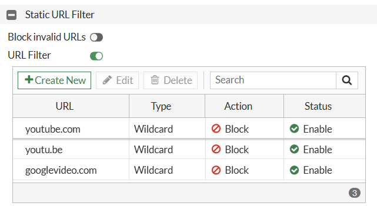

<svg xmlns="http://www.w3.org/2000/svg"
     width="800" height="450" viewBox="0 0 1200 630"
     role="img" aria-labelledby="title desc">

  <title id="title">Block a Website or URL on FortiGate</title>
  <desc id="desc">FortiGate Web Filter and Firewall Policy blocking unwanted websites.</desc>

  <defs>
    <linearGradient id="bg" x1="0" y1="0" x2="1" y2="1">
      <stop offset="0%" stop-color="#f5f9ff"/>
      <stop offset="100%" stop-color="#dceaff"/>
    </linearGradient>

    <linearGradient id="device" x1="0" y1="0" x2="0" y2="1">
      <stop offset="0%" stop-color="#344e6b"/>
      <stop offset="100%" stop-color="#10243c"/>
    </linearGradient>

    <linearGradient id="blue" x1="0" y1="0" x2="1" y2="1">
      <stop offset="0%" stop-color="#2388ef"/>
      <stop offset="100%" stop-color="#0751ad"/>
    </linearGradient>

    <linearGradient id="red" x1="0" y1="0" x2="1" y2="1">
      <stop offset="0%" stop-color="#ff5265"/>
      <stop offset="100%" stop-color="#d90f36"/>
    </linearGradient>

    <filter id="shadow" x="-30%" y="-30%" width="160%" height="170%">
      <feDropShadow dx="0" dy="7" stdDeviation="8"
                    flood-color="#17365d" flood-opacity=".18"/>
    </filter>
  </defs>

  <!-- Background -->
  <rect width="1200" height="630" rx="20" fill="url(#bg)"/>
  <circle cx="40" cy="360" r="200" fill="#ffffff" opacity=".25"/>
  <circle cx="1160" cy="300" r="220" fill="#ffffff" opacity=".28"/>

  <!-- Main heading -->
  <text x="600" y="63" text-anchor="middle"
        font-family="Arial, sans-serif" font-size="37"
        font-weight="700" fill="#102e63">
    Block a Website or URL on
  </text>

  <rect x="380" y="79" width="440" height="57" rx="13" fill="url(#red)"/>
  <text x="600" y="118" text-anchor="middle"
        font-family="Arial, sans-serif" font-size="39"
        font-weight="700" fill="#ffffff">FortiGate</text>

  <text x="600" y="170" text-anchor="middle"
        font-family="Arial, sans-serif" font-size="27"
        font-weight="700" fill="#173c77">
    Using Web Filter and Firewall Policy
  </text>

  <!-- LEFT: Browser / blocked website -->
  <g filter="url(#shadow)">
    <rect x="35" y="215" width="340" height="260" rx="15"
          fill="#ffffff" stroke="#345576" stroke-width="5"/>

    <path d="M35 258 V230 Q35 215 50 215 H360 Q375 215 375 230 V258 Z"
          fill="#dce9fa"/>

    <circle cx="59" cy="237" r="6" fill="#fa5364"/>
    <circle cx="79" cy="237" r="6" fill="#ffbd4a"/>
    <circle cx="99" cy="237" r="6" fill="#37bb80"/>

    <!-- URL bar -->
    <rect x="53" y="269" width="304" height="35" rx="9"
          fill="#f0f5fd" stroke="#c8d8ef" stroke-width="2"/>

    <circle cx="72" cy="286" r="7" fill="none"
            stroke="#315b91" stroke-width="2"/>
    <path d="M67 286 H77 M72 279 Q67 286 72 293 M72 279 Q77 286 72 293"
          fill="none" stroke="#315b91" stroke-width="1.5"/>

    <text x="88" y="292" font-family="Arial, sans-serif"
          font-size="15" font-weight="600" fill="#233d60">
      blocked-website.com
    </text>

    <!-- Access denied panel -->
    <rect x="53" y="318" width="304" height="137" rx="12" fill="#fff0f2"/>

    <circle cx="205" cy="355" r="22" fill="none"
            stroke="#ed2443" stroke-width="7"/>
    <path d="M190 340 L220 370" stroke="#ed2443"
          stroke-width="7" stroke-linecap="round"/>

    <text x="205" y="400" text-anchor="middle"
          font-family="Arial, sans-serif" font-size="25"
          font-weight="700" fill="#d7193f">ACCESS DENIED</text>

    <text x="205" y="425" text-anchor="middle"
          font-family="Arial, sans-serif" font-size="14"
          fill="#78404a">Blocked by FortiGate Web Filter</text>

    <text x="205" y="443" text-anchor="middle"
          font-family="Arial, sans-serif" font-size="12"
          fill="#78404a">Website access restricted</text>
  </g>

  <!-- Connector from browser to firewall -->
  <path d="M380 350 H465" fill="none"
        stroke="#e52645" stroke-width="6"
        stroke-dasharray="10 9" stroke-linecap="round"/>

  <circle cx="422" cy="350" r="19" fill="#ffffff"
          stroke="#e52645" stroke-width="4"/>
  <path d="M414 342 L430 358 M430 342 L414 358"
        stroke="#e52645" stroke-width="4" stroke-linecap="round"/>

  <!-- CENTER: FortiGate appliance -->
  <g filter="url(#shadow)">

    <!-- Firewall body -->
    <path d="M440 340 L465 312 H750 L780 340 V428
             Q780 441 766 441 H454 Q440 441 440 428 Z"
          fill="url(#device)"/>

    <!-- Top surface -->
    <path d="M440 340 L465 312 H750 L780 340 Z"
          fill="#607c9b"/>

    <path d="M452 339 H766" stroke="#a9bfd8"
          stroke-width="2" opacity=".7"/>

    <!-- Ventilation slots -->
    <g fill="#091a2d">
      <rect x="455" y="359" width="31" height="6" rx="3"/>
      <rect x="455" y="372" width="31" height="6" rx="3"/>
      <rect x="455" y="385" width="31" height="6" rx="3"/>
      <rect x="455" y="398" width="31" height="6" rx="3"/>
      <rect x="455" y="411" width="31" height="6" rx="3"/>
    </g>

    <!-- Generic firewall symbol -->
    <g transform="translate(510 359)" fill="#ff4359">
      <rect x="0" y="0" width="17" height="13" rx="2"/>
      <rect x="21" y="0" width="17" height="13" rx="2"/>
      <rect x="42" y="0" width="17" height="13" rx="2"/>
      <rect x="0" y="17" width="17" height="13" rx="2"/>
      <rect x="42" y="17" width="17" height="13" rx="2"/>
      <rect x="0" y="34" width="17" height="13" rx="2"/>
      <rect x="21" y="34" width="17" height="13" rx="2"/>
      <rect x="42" y="34" width="17" height="13" rx="2"/>
    </g>

    <text x="585" y="385" font-family="Arial, sans-serif"
          font-size="25" font-weight="700" fill="#ffffff">FortiGate</text>

    <text x="585" y="407" font-family="Arial, sans-serif"
          font-size="12" font-weight="600" fill="#b9d4f5">
      NEXT-GENERATION FIREWALL
    </text>

    <!-- Status lights -->
    <circle cx="735" cy="369" r="5" fill="#4be19a"/>
    <circle cx="735" cy="385" r="5" fill="#4be19a"/>
    <circle cx="735" cy="401" r="5" fill="#ffcb55"/>
  </g>

  <!-- Web Filter label -->
  <g filter="url(#shadow)">
    <rect x="420" y="207" width="166" height="79" rx="13" fill="url(#blue)"/>

    <!-- Globe icon -->
    <circle cx="452" cy="235" r="15" fill="none"
            stroke="#ffffff" stroke-width="2.5"/>
    <path d="M437 235 H467 M452 220 Q441 235 452 250
             M452 220 Q463 235 452 250"
          fill="none" stroke="#ffffff" stroke-width="2"/>

    <text x="503" y="241" text-anchor="middle"
          font-family="Arial, sans-serif" font-size="18"
          font-weight="700" fill="#ffffff">WEB FILTER</text>

    <text x="503" y="263" text-anchor="middle"
          font-family="Arial, sans-serif" font-size="12"
          fill="#e7f2ff">URL Filtering</text>
  </g>

  <!-- Firewall Policy label -->
  <g filter="url(#shadow)">
    <rect x="610" y="207" width="185" height="79" rx="13" fill="#6845cb"/>

    <!-- Policy document icon -->
    <path d="M629 222 H647 L656 231 V258 H629 Z"
          fill="none" stroke="#ffffff" stroke-width="2.5"
          stroke-linejoin="round"/>
    <path d="M647 222 V231 H656 M635 239 H649 M635 246 H649 M635 253 H644"
          fill="none" stroke="#ffffff" stroke-width="2"/>

    <text x="718" y="241" text-anchor="middle"
          font-family="Arial, sans-serif" font-size="16"
          font-weight="700" fill="#ffffff">FIREWALL</text>

    <text x="718" y="261" text-anchor="middle"
          font-family="Arial, sans-serif" font-size="16"
          font-weight="700" fill="#ffffff">POLICY</text>
  </g>

  <!-- Policy arrows -->
  <path d="M500 286 V300" stroke="#1680df"
        stroke-width="4" stroke-linecap="round"/>
  <path d="M491 294 L500 304 L509 294"
        fill="none" stroke="#1680df" stroke-width="4"
        stroke-linecap="round" stroke-linejoin="round"/>

  <path d="M703 286 V300" stroke="#6845cb"
        stroke-width="4" stroke-linecap="round"/>
  <path d="M694 294 L703 304 L712 294"
        fill="none" stroke="#6845cb" stroke-width="4"
        stroke-linecap="round" stroke-linejoin="round"/>

  <!-- Connector to blocked destination -->
  <path d="M785 350 H845" fill="none"
        stroke="#e52645" stroke-width="6"
        stroke-dasharray="10 9" stroke-linecap="round"/>

  <circle cx="815" cy="350" r="18" fill="#ffffff"
          stroke="#e52645" stroke-width="4"/>
  <path d="M807 342 L823 358 M823 342 L807 358"
        stroke="#e52645" stroke-width="4" stroke-linecap="round"/>

  <!-- RIGHT: blocked destination -->
  <g filter="url(#shadow)">
    <rect x="855" y="242" width="302" height="190" rx="15"
          fill="#ffffff" stroke="#ed4058" stroke-width="4"/>

    <path d="M855 257 Q855 242 870 242 H1142 Q1157 242 1157 257 V271 H855 Z"
          fill="#dce8f7"/>

    <circle cx="875" cy="257" r="5" fill="#fa5364"/>
    <circle cx="893" cy="257" r="5" fill="#ffbd4a"/>
    <circle cx="911" cy="257" r="5" fill="#37bb80"/>

    <!-- Large blocked icon -->
    <circle cx="1006" cy="328" r="42" fill="none"
            stroke="#ed2443" stroke-width="11"/>
    <path d="M977 299 L1035 357" stroke="#ed2443"
          stroke-width="11" stroke-linecap="round"/>

    <rect x="855" y="384" width="302" height="48" rx="0"
          fill="url(#red)"/>

    <text x="1006" y="414" text-anchor="middle"
          font-family="Arial, sans-serif" font-size="21"
          font-weight="700" fill="#ffffff">URL BLOCKED</text>
  </g>

  <!-- Bottom information strip -->
  <rect x="25" y="485" width="1150" height="119" rx="17"
        fill="#ffffff" stroke="#c6d8f2" stroke-width="2"/>

  <!-- Item 1 -->
  <g transform="translate(62 512)">
    <path d="M25 0 L48 9 V29 Q48 47 25 59 Q2 47 2 29 V9 Z"
          fill="none" stroke="#1c579e" stroke-width="4"/>
    <path d="M13 29 L22 38 L38 20" fill="none"
          stroke="#1c579e" stroke-width="4"
          stroke-linecap="round" stroke-linejoin="round"/>
  </g>

  <text x="128" y="539" font-family="Arial, sans-serif"
        font-size="17" font-weight="700" fill="#163c76">SECURE</text>
  <text x="128" y="561" font-family="Arial, sans-serif"
        font-size="17" font-weight="700" fill="#163c76">WEB ACCESS</text>

  <path d="M294 505 V584" stroke="#cfddf0" stroke-width="2"/>

  <!-- Item 2 -->
  <g transform="translate(323 519)" fill="none"
     stroke="#1c579e" stroke-width="3">
    <circle cx="27" cy="27" r="24"/>
    <path d="M3 27 H51 M27 3 Q9 27 27 51 M27 3 Q45 27 27 51"/>
  </g>

  <text x="383" y="539" font-family="Arial, sans-serif"
        font-size="17" font-weight="700" fill="#163c76">URL</text>
  <text x="383" y="561" font-family="Arial, sans-serif"
        font-size="17" font-weight="700" fill="#163c76">CONTROL</text>

  <path d="M535 505 V584" stroke="#cfddf0" stroke-width="2"/>

  <!-- Item 3 -->
  <g transform="translate(565 520)" fill="none"
     stroke="#1c579e" stroke-width="4" stroke-linejoin="round">
    <path d="M0 10 L22 0 L44 10 V35 L22 47 L0 35 Z"/>
    <path d="M13 24 L20 31 L33 17" stroke-linecap="round"/>
  </g>

  <text x="622" y="539" font-family="Arial, sans-serif"
        font-size="17" font-weight="700" fill="#163c76">POLICY</text>
  <text x="622" y="561" font-family="Arial, sans-serif"
        font-size="17" font-weight="700" fill="#163c76">ENFORCEMENT</text>

  <path d="M817 505 V584" stroke="#cfddf0" stroke-width="2"/>

  <!-- Item 4 -->
  <g transform="translate(848 520)" fill="none"
     stroke="#1c579e" stroke-width="4" stroke-linejoin="round">
    <path d="M23 0 L46 9 V27 Q46 43 23 54 Q0 43 0 27 V9 Z"/>
    <rect x="15" y="23" width="16" height="13" rx="3"/>
    <path d="M19 23 V18 Q23 10 27 18 V23"/>
  </g>

  <text x="910" y="539" font-family="Arial, sans-serif"
        font-size="17" font-weight="700" fill="#163c76">NETWORK</text>
  <text x="910" y="561" font-family="Arial, sans-serif"
        font-size="17" font-weight="700" fill="#163c76">PROTECTION</text>

</svg>

## Overview

FortiGate Web Filter allows network administrators to block access to specific websites `www.youtube.com`, domains, and URL paths. 

## Configuration workflow

<svg xmlns="http://www.w3.org/2000/svg"
     viewBox="0 0 600 180"
     width="100%"
     role="img"
     aria-label="FortiGate URL filtering workflow">

  <rect width="600" height="180" rx="12" fill="#f1f5f9"/>

  <rect x="15" y="35" width="165" height="100"
        rx="10" fill="#fff" stroke="#dc2626" stroke-width="2"/>

  <text x="97" y="65" text-anchor="middle"
        font-size="15" font-weight="bold" fill="#172554">
    Step 1
  </text>
  <text x="97" y="90" text-anchor="middle"
        font-size="12" fill="#334155">
    Create URL Filter Profile
  </text>

  <path d="M185 85 H215" stroke="#dc2626" stroke-width="3"/>
  <polygon points="215,79 225,85 215,91" fill="#dc2626"/>

  <rect x="230" y="35" width="165" height="100"
        rx="10" fill="#fff" stroke="#dc2626" stroke-width="2"/>

  <text x="312" y="65" text-anchor="middle"
        font-size="15" font-weight="bold" fill="#172554">
    Step 2
  </text>
  <text x="312" y="88" text-anchor="middle"
        font-size="12" fill="#334155">
    Apply Web Filter Profile
  </text>
  <text x="312" y="105" text-anchor="middle"
        font-size="12" fill="#334155">
    to Firewall Policy
  </text>

  <path d="M400 85 H430" stroke="#dc2626" stroke-width="3"/>
  <polygon points="430,79 440,85 430,91" fill="#dc2626"/>

  <rect x="445" y="35" width="140" height="100"
        rx="10" fill="#fff" stroke="#16a34a" stroke-width="2"/>

  <text x="515" y="65" text-anchor="middle"
        font-size="15" font-weight="bold" fill="#166534">
    Step 3
  </text>
  <text x="515" y="90" text-anchor="middle"
        font-size="12" fill="#334155">
    Test &amp; Verify
  </text>

</svg>

**Step 1 — Create the URL filter**  
Security Profiles → Web Filter

**Step 2 — Apply the Web Filter profile**  
Policy & Objects → Firewall Policy

**Step 3 — Test and verify**
## Step 1. Create a Web Filter profile

1. Log in to the FortiGate administrative GUI.
	
2. Navigate to Security Profiles → Web Filter.
	
3. Click Create New
	
4. Enter a profile name, for example, `Block_Websites`. 
    
5. Locate the Static URL Filter section.
    
6. Enable URL Filter.

***Reference:** Fortinet's FortiOS 7.4.8 Administration Guide. Your interface may differ slightly.*
Official reference: [Fortinet — Static URL Filter](https://docs.fortinet.com/document/fortigate/7.4.8/administration-guide/371670/static-url-filter) 

### Add the URL to block

In the Static URL Filter section:

1. Click Create New.
    
2. Enter the URL pattern. `www.youtube.com`
    
3. Select the filter type Wildcard.
    
4. Set the action to Block.
    
5. Set the status Enabled.
    
6. Save the entry and then save the profile.

Use the following example configuration:

| Field  | Value         |
| ------ | ------------- |
| URL    | `youtube.com` |
| Type   | Wildcard      |
| Action | Block         |
| Status | Enabled       |

## Step 2: Apply the Web Filter to a firewall policy

A URL filter will not protect users unless the applicable traffic passes through a firewall policy with the Web Filter profile enabled.

1. Go to Policy & Objects → Firewall Policy.
    
2. Find the policy that allows LAN users to access the Internet (LAN-to-WAN).
    
3. Click Edit.
    
4. Locate the Security Profiles section.
    
5. Enable Web Filter.
    
6. Select the `Block_Websites` profile created earlier.
    
7. Select `certificate-inspection` under SSL Inspection, as an initial configuration.
    
8. Click OK to save.

Use the following example configuration:

Official reference: [Fortinet — Static URL Filter and Firewall Policy](https://docs.fortinet.com/document/fortigate/7.4.8/administration-guide/371670/static-url-filter) 

## Step 3: Test & Verify

From a client computer connected through the FortiGate:

1. Open a browser.
    
2. Navigate to `https://www.youtube.com`.
    
3. Confirm that access is blocked.
    
4. Test another website to verify that general Internet access still works.
    

### Expected result

**Blocked website**

The browser should display a FortiGate block or replacement page, or the request may fail depending on the inspection and browser configuration.

**Other websites should be run.**

Websites not matched by a blocking rule should remain accessible.

## Check Web Filter logs

If the website is still accessible, check the logs:

1. Navigate to Log & Report → Security Events.
    
2. Open the Web Filter events.
    
3. Filter for the client's source IP address or the destination hostname.
    
4. Review the action, matched URL, profile, and policy ID.
	
5. Look for an entry with an action such as `blocked` and a message indicating that the URL matched the local URL filter.

Official reference: [Fortinet — Static URL Filter and verification](https://docs.fortinet.com/document/fortigate/7.4.8/administration-guide/371670/static-url-filter) 
